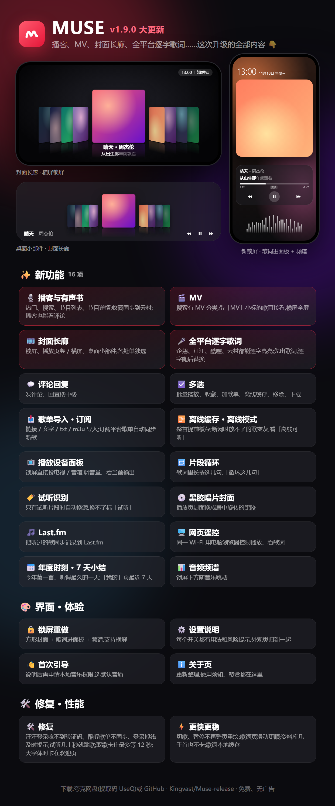

# MUSE

All Music. In One. —— Apple Music 风格的 Android 多平台音乐播放器。免费、无广告。

作者:**Charon**

> 这个仓库只用来检查更新,不包含源代码,也不再提供安装包下载。

## 获取

安装包不再公开下载。请打开作者的[小红书主页](https://xhslink.cn/o/6gFgxqDDGpg)进群,向群主索要下载链接。

拿到后直接安装,覆盖旧版本即可,数据不会丢。App 里「我的 › 关于 MUSE」可以检查更新。

> **使用须知**:MUSE 是免费的个人学习项目,本身不提供、不存储任何音乐内容;只播放你的账号本身有权播放的内容,
> 不破解加密、不绕过会员与付费限制、不提供平台音乐下载。仅供个人学习交流,**禁止任何商业用途**,禁止二次打包收费分发。
> 各平台通过其网页接口接入,并非官方合作,接口随时可能失效;因使用产生的任何问题由使用者自行承担。
> 如果你是权利人,认为本项目侵犯了你的权益,请提 Issue 联系,会尽快处理或移除相关功能。

## 音源

各平台在 App 和本文中都用代称(社区通用叫法),不使用平台名称与官方图标。

| 音源 | 说明 |
|---|---|
| 本地音乐 | MediaStore 扫描,支持 FLAC / Hi-Res 信息展示 |
| NAS | Subsonic / Navidrome 协议,可选音质、下载到本地(仅限你自己的服务器) |
| 企鹅 / 云村 / 汪汪 / 酷喔 | 在应用内登录自己的账号,通过平台网页接口接入,只播放账号有权播放的歌曲 |
| 咕咕 | 免登录,只播放平台标注为免费的歌曲与音质 |
| 小汽 | 仅支持粘贴分享链接:识别歌名歌手后在上面的平台播放。其音频有 DRM 加密与客户端签名,MUSE 不破解 |

## 功能亮点

- **跨平台聚合**:每日推荐、全网热歌/新歌/飙升榜,同一首歌只保留一个版本;可切换「聚合」或只看某个平台
- **搜索**:多平台聚合搜索与联想,结果里还有 MV 和播客;带「MV」小标的歌可以直接看 MV
- **自动换源**:某平台放不了(会员/版权/未登录)时,各平台同时找同一首,用第一个你有权播放的
- **真实音质**:显示平台实际给出的档位与码率;「跨平台最高音质」在同一首歌的多个版本里选最高档
- **收藏**:MUSE 收藏 + 各平台「我喜欢」汇总;多选批量收藏、加歌单、离线缓存(只存进本机播放缓存,不导出文件)
- **歌词**:逐字歌词、翻译、罗马音;翻唱自动匹配原唱歌词;悬浮歌词;蓝牙/通知/超级岛歌词
- **评论**:多平台评论,可直接发评论、回复楼中楼
- **MV 与播客**:歌曲 MV(横屏全屏);播客与有声书,可收藏播客,播放页显示节目详情
- **锁屏播放页**:三种样式可预览选择(标准、经典、封面长廊),横屏自动切换,音频频谱;左右滑封面切歌,上滑回系统锁屏
- **播放**:A-B 段落循环、睡眠定时、倍速、淡入淡出、音频焦点、均衡器(按输出设备记忆)
- **车载模式 / 桌面小部件 / Android Auto**
- **听歌识曲**:Shazam 指纹算法(纯 Kotlin 实现),识别后在各平台找可播放版本
- **记录与统计**:播放统计、听歌日历、年度时刻;可同步到 Last.fm
- **网页遥控**:同一 Wi-Fi 下用电脑浏览器控制播放、看滚动歌词(访问地址带一次性口令)
- **更多**:相似歌曲电台、平台电台、歌单链接导入、音乐闹钟、备份与 WebDAV 同步、歌词海报
- **液态玻璃**:参考 iOS 27,用 [AndroidLiquidGlass](https://github.com/Kyant0/AndroidLiquidGlass) 实时折射(Android 13+);关闭后全部为实色
- **界面**:Apple Music 风格,强调色跟随封面

## 请作者喝杯咖啡

赞赏完全自愿,不解锁任何功能。App 里在「我的 › 关于 MUSE › 请作者喝杯咖啡」。

  
  &nbsp;&nbsp;
  

## 问题反馈

在本仓库提 [Issue](https://github.com/Kingvast/Muse-release/issues)。
